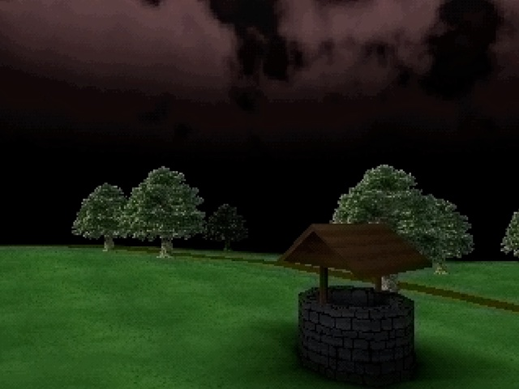
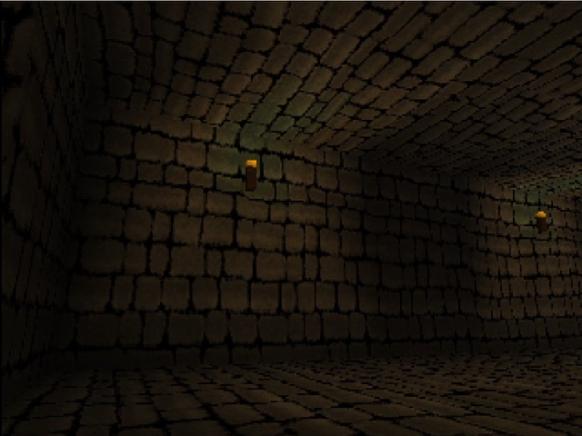
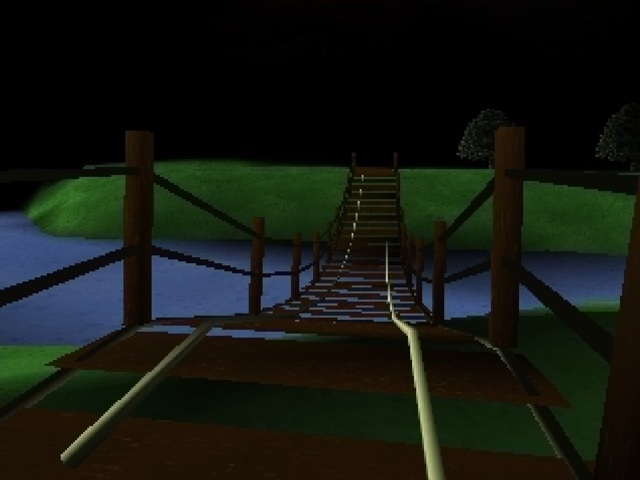

# Dreamfield

<a href="screenshots/village.jpg"></a>
<a href="screenshots/dungeon.jpg"></a>
<a href="screenshots/bridge.jpg"></a>

A dark, PS1-style first person RPG inspired by FromSoftware's King's Field. I put a lot
of effort into the aesthetic, and the renderer tries pretty hard to look like it's
actually running on a PlayStation plugged into an old CRT over composite.

It's very much a work in progress. Right now it's more of a tech demo or vertical slice
than a game: there's a splash screen and title screen, a little village with a well,
trees, a river and a rope bridge, a dungeon to wander around in, and a minecart you can
push around and ride. There's no combat or story yet. I'll probably come back and finish
it one day.

Everything is written by hand in Rust, including the OpenGL renderer, the collision
detection and the world builder. This was a pre-AI project, apart from the last couple
of commits. The only real engine-ish dependency is `bevy_ecs` for the ECS.

## The PS1 look

The game renders at 320x240 and then gets scaled up, and on top of that it fakes most of
the quirks that made PS1 games look the way they did:

* **Wobbly vertices.** The PS1 had no subpixel precision, so vertices snapped to whole
  pixels and everything jittered as the camera moved. The vertex shader snaps every
  vertex to the 320x240 pixel grid to get the same thing.
* **Affine texture mapping.** The PS1 didn't do perspective correct texturing, so
  textures warp and swim across big polygons. The shaders interpolate everything with
  `noperspective` to get that warping back.
* **Tessellation.** PS1 games used to subdivide polygons near the camera to hide the
  worst of the affine warping. I do the same thing with a tessellation shader that
  subdivides more the closer you get, and because every new vertex gets snapped too, it
  makes the walls bend and wobble in that really nice way (you can see it in the dungeon
  screenshot).
* **Dithering.** It uses the actual 4x4 dither matrix the PS1 GPU used, so gradients
  get that grainy look instead of banding.
* **Vertex lighting and fog**, baked per vertex, with distance fog to hide the draw
  distance, just like the originals had to.

## Analog TV simulation

After the scene is rendered it goes through a composite video pass to simulate the
signal degrading on its way to the TV. The colours get crushed down to 5 bits per
channel (like the PS1's 15-bit colour), then converted to YIQ, which is the colour space
NTSC uses to send the signal. The brightness (Y) is kept at full resolution, but the two
colour channels (I and Q) are sampled at lower resolutions, the same way a composite
signal has way less bandwidth for colour than for brightness. Then it's converted back
to RGB, so you get the soft colour bleeding and smearing you'd see on a real TV.

## Other stuff

* **Collision.** The player collides with the world as a swept ellipsoid against the
  raw triangle soup of the level, with Quake-style sliding along surfaces, so you can
  walk up slopes and slide along walls without getting stuck or falling through things.
  This took an embarrassingly long time to get right.
* **World builder.** The levels are made in Blender and exported as glTF. At build time
  `build.rs` chops them up into chunks with their collision data and bakes them into the
  executable, so the game is a single exe.
* **Entities.** Things like the elf and the minecart are placed in Blender and spawned
  into the ECS when the level loads. The minecart follows a track that's also just a
  mesh in the Blender scene.
* **Skinned animation** (the elf has an idle animation) and text rendering with bitmap
  fonts.

## Getting it running

You'll need Rust and CMake (the `glfw` crate builds GLFW from source). Then just:

```
cargo run --release
```

The first build takes a bit because it has to build the world chunks.

## Controls

* WASD to move, mouse to look (click the window to capture the mouse, left alt to
  release it). The arrow keys or IJKL also look around.
* Shift to run, space to jump, E to use things (like getting in and out of the
  minecart).
* Escape to pause.
* F1 shows diagnostics, F2 toggles wireframe, F3 shows the colliders.
